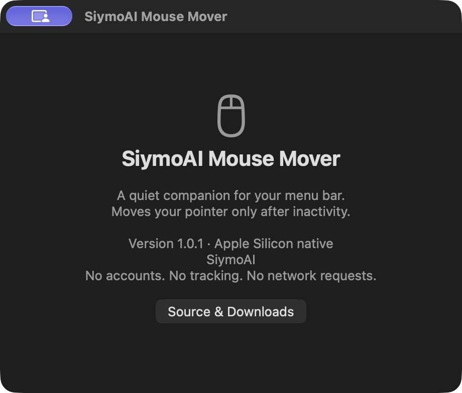
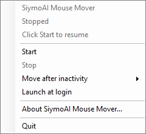
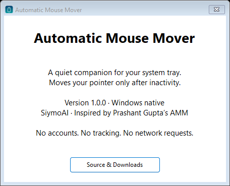

# Automatic Mouse Mover

A small menu bar app for **Apple Silicon Macs** and a system tray app for **Windows x64**. Gently moves your pointer after inactivity, with the simple Start / Stop experience of [Prashant Gupta’s original AMM](https://github.com/prashantgupta24/automatic-mouse-mover).

Built with AppKit / Core Graphics on macOS and WinForms / Win32 on Windows. No terminal windows, accounts, telemetry, browser engine, or background service. The Windows download includes its .NET runtime.

## Download

| Platform | Installer | Alternative |
| --- | --- | --- |
| Apple Silicon · macOS 13+ | [Download DMG](https://github.com/SiymoAI/automatic-mouse-mover-native/releases/latest/download/Automatic-Mouse-Mover-1.0.0-macos-arm64.dmg) | [App ZIP](https://github.com/SiymoAI/automatic-mouse-mover-native/releases/latest/download/Automatic-Mouse-Mover-1.0.0-macos-arm64.zip) |
| Windows 10/11 · x64 | [Download Setup](https://github.com/SiymoAI/automatic-mouse-mover-native/releases/latest/download/Automatic-Mouse-Mover-1.0.0-windows-x64-setup.exe) | [Portable ZIP](https://github.com/SiymoAI/automatic-mouse-mover-native/releases/latest/download/Automatic-Mouse-Mover-1.0.0-windows-x64-portable.zip) |

[All releases, checksums, screenshots, and test results](https://github.com/SiymoAI/automatic-mouse-mover-native/releases/latest)

### macOS

1. Open the DMG and drag **Automatic Mouse Mover** to **Applications**.
2. Open the app. Its mouse icon appears in the menu bar; there is no Dock icon.
3. This release is ad hoc signed, **not Apple-notarized**. If macOS blocks the first launch, open **System Settings → Privacy & Security → Open Anyway** after attempting to open it. Do not disable Gatekeeper.
4. From the mouse menu, choose **Allow mouse movement…**, then **Open Accessibility Settings**. Enable **Automatic Mouse Mover** under **Privacy & Security → Accessibility**.
5. The app detects permission changes automatically. Choose **Start** if it is stopped.

No Screen Recording or Input Monitoring permission is required. The app reads elapsed time since input, never keystrokes or screen contents. An installed app needs its own Accessibility approval even if a development test launched from a trusted terminal already works.

### Windows

1. Run **Automatic-Mouse-Mover-1.0.0-windows-x64-setup.exe**. It installs for your account without administrator privileges and adds a Start Menu shortcut and uninstaller.
2. Launch **Automatic Mouse Mover** from Start. Its icon appears in the notification area beside the clock. Windows may initially put it under **Show hidden icons**; drag it into the visible tray if preferred.
3. Click or right-click the icon for **Start**, **Stop**, and settings. No console or permanent application window appears.

The Windows app and installer are **not Authenticode signed**; Windows may show an unknown-publisher / SmartScreen warning. Verify the SHA-256 checksum and source before choosing to run it. No separately installed .NET runtime is needed. For portable use, extract the ZIP and open `AutomaticMouseMover.exe`.

## How it behaves

- Starts enabled on a fresh installation and waits **60 seconds of inactivity** before moving. Start/Stop and the interval are saved between launches.
- Choose **30 seconds, 1 minute, 2 minutes, or 5 minutes** from **Move after inactivity**.
- Moves horizontally by two pixels and alternates direction. Movement stays within the current display, including displays with negative coordinates.
- Waits while you type, click, drag, or hold modifier keys. There is no delayed “return” movement that could fight your input.
- Pauses while the screen is locked, the computer sleeps, or the Windows session is disconnected. It waits a full interval after resuming.
- **Launch at login** is optional and off by default. macOS uses its standard Login Items service; Windows uses a per-user startup entry. macOS may require approval in **General → Login Items**.
- **Quit** exits completely. **About** is the only optional app window.

This app does not bypass managed lock policies, wake a closed laptop, or guarantee a particular status in messaging applications. Elevated Windows apps and secure desktops can block simulated input; the app reports a blocked movement rather than requesting administrator access.

## Screenshots

macOS About window, captured from the installed arm64 app:



Windows tray menu and About window, captured from the app’s real WinForms controls during its interactive tests:




## Build from source

### macOS

Requires Xcode Command Line Tools (Swift and the macOS SDK). No third-party packages.

```sh
./scripts/build-macos.sh
swiftc macos/MoverPolicy.swift tests/PolicyTests.swift -o build/policy-tests
./build/policy-tests
```

Outputs the arm64 `.app` in `build/` and the DMG / ZIP in `dist/`. The deployment target is macOS 13. The default signature is ad hoc. A future signed release can set `MAC_SIGN_IDENTITY` to a **Developer ID Application** certificate and `NOTARY_PROFILE` to an existing `notarytool` keychain profile; the script then notarizes and staples the app and DMG. No signing secrets belong in this repository.

### Windows

Requires the .NET 10 SDK (LTS). Run PowerShell from the repository:

```powershell
./scripts/prepare-windows-tools.ps1
./scripts/build-windows.ps1
./scripts/verify-windows-binary.ps1
```

The preparation script downloads **Inno Setup 6.4.3** from its official release and verifies a pinned SHA-256. This version permits commercial use under its [license](https://github.com/jrsoftware/issrc/blob/is-6_4_3/license.txt). The app is a self-contained `win-x64` GUI executable. Setup and portable ZIP are written to `dist/`.

### Tests

[Validation notes](docs/TESTING.md) describe real hardware tests and remaining limitations. Diagnostic modes are optional and never write runtime reports during ordinary launches.

```sh
# Run with the GUI app closed; saves control and policy checks.
"build/Automatic Mouse Mover.app/Contents/MacOS/AutomaticMouseMover" \
  --self-test --diagnostics "$PWD/build/macos-self-test.json"
```

An optional macOS OS-input test can be compiled from `tests/MacInputIntegration.swift` with `swiftc -parse-as-library`. It needs a trusted Accessibility host and posts only a Shift press/release while the app’s About window is focused; it verifies that keyboard input resets the real idle counter.

On Windows, `scripts/test-windows-interactive.ps1` runs the actual app’s tests in the current signed-in user’s desktop through a temporary named scheduled task. A disconnected or locked desktop intentionally fails its movement assertion. The report and control screenshots go to `artifacts/`. Remove the test task afterward:

```powershell
Unregister-ScheduledTask -TaskName AutomaticMouseMover-Native-Test -Confirm:$false
```

GitHub Actions builds both installers on every push. Release binaries are published after hardware validation, with checksums.

## Uninstall

**macOS:** Quit from the menu, turn off Launch at login if enabled, and move the app from Applications to Trash. Remove its Accessibility entry in System Settings if desired.

**Windows:** Quit from the tray, then use **Settings → Apps → Installed apps → Automatic Mouse Mover → Uninstall**. The uninstaller removes the startup entry and shortcuts. Preferences remain in `%LOCALAPPDATA%\SiymoAI\AutomaticMouseMover` so reinstalls retain your choices; delete that folder if you want a clean reset.

## Credits and license

MIT licensed. This is an independent native reimplementation inspired by **Prashant Gupta’s Automatic Mouse Mover**. The original is Go-based; its latest v1.3.0 binary is Intel-only. Original credit and the MIT notice are retained in [LICENSE](LICENSE). macOS uses only Apple frameworks; Windows uses Microsoft .NET 10 LTS and Win32. Windows installers are built with Jordan Russell and Martijn Laan’s Inno Setup.
